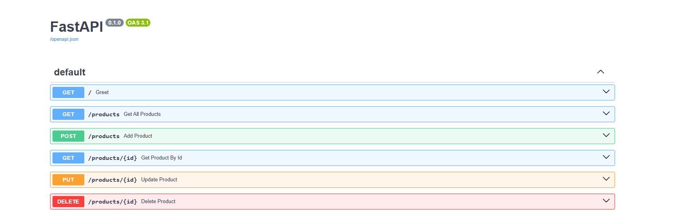
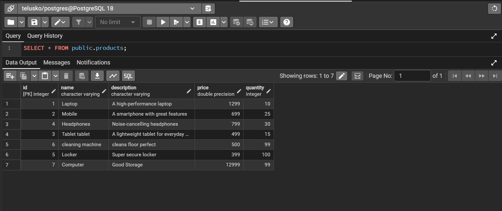
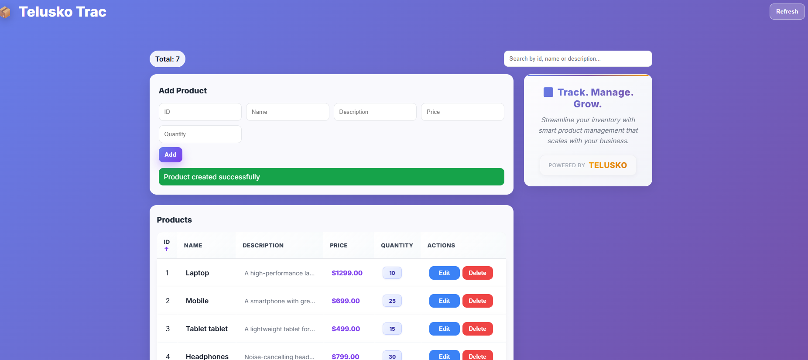

# FastAPI PostgreSQL CRUD Project

A REST API project built using **FastAPI, Python, SQLAlchemy, and PostgreSQL**. This project demonstrates basic CRUD (Create, Read, Update, Delete) operations for managing product records in a PostgreSQL database.

## Project Introduction

This project is a simple Product Management REST API developed using FastAPI and PostgreSQL.

It allows users to create, retrieve, update, and delete product records through API endpoints. Swagger UI is used for interactive API testing.

## Features

- Create a new product.
- Retrieve all products.
- Retrieve a product by ID.
- Update existing product details.
- Delete a product.
- PostgreSQL database integration.
- Interactive API documentation using Swagger UI.
- SQLAlchemy for database operations.

## Technologies Used

- **Python** – Programming language
- **FastAPI** – Backend web framework
- **PostgreSQL** – Relational database
- **SQLAlchemy** – ORM for database interaction
- **Pydantic** – Data validation
- **Uvicorn** – ASGI server
- **Swagger UI** – API documentation and testing

## Project Structure

```text
FastAPI-PostgreSQL-CRUD/
│
├── main.py
├── models.py
├── database.py
├── database_models.py
├── requirements.txt
├── .gitignore
├── README.md
│
└── screenshots/
    ├── swagger-ui.png
    └── database.png
```

##  Installation and Setup

### 1. Clone the Repository

```bash
git clone YOUR_GITHUB_REPOSITORY_URL
```

### 2. Navigate to Project Directory

```bash
cd FastAPI-PostgreSQL-CRUD
```

### 3. Create Virtual Environment

```bash
python -m venv myenv
```

### 4. Activate Virtual Environment

For Windows:

```bash
myenv\Scripts\activate
```

### 5. Install Dependencies

```bash
pip install -r requirements.txt
```

### 6. Configure PostgreSQL Database

- Install and start PostgreSQL.
- Create a database for the project.
- Configure your database connection string in `database.py`.

**Note:** Keep database credentials private. Do not upload passwords to GitHub.

### 7. Run the Application

```bash
python -m uvicorn main:app --reload
```

The application will run at:

```text
http://127.0.0.1:8000
```

##  API Endpoints

| Method | Endpoint | Description |
|---|---|---|
| GET | `/` | Welcome message |
| GET | `/products` | Get all products |
| GET | `/product/{id}` | Get product by ID |
| POST | `/product` | Add a new product |
| PUT | `/product/{id}` | Update product |
| DELETE | `/product/{id}` | Delete product |

## API Documentation

FastAPI provides interactive API documentation through Swagger UI.

After starting the server, open:

```text
http://127.0.0.1:8000/docs
```

You can test all CRUD operations directly through Swagger UI.

## Screenshots







## Author

**Ayushi Bharti**

GitHub: [Your GitHub Profile](YOUR_GITHUB_PROFILE_URL)

---
